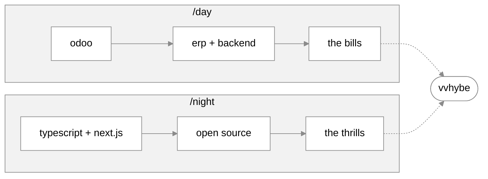
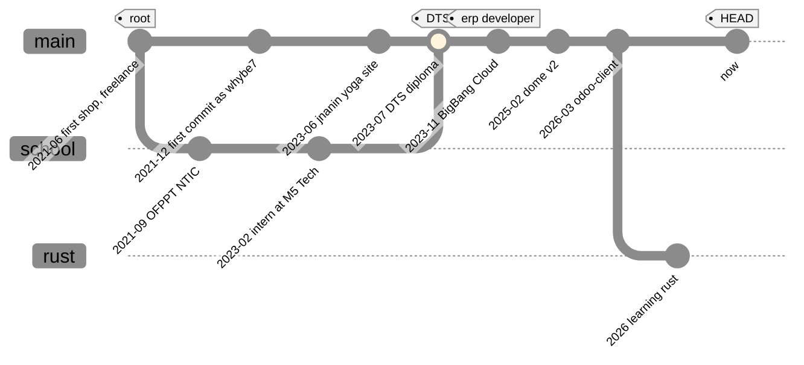

<div align="center">

```txt
██╗   ██╗██╗   ██╗██╗  ██╗██╗   ██╗██████╗ ███████╗
██║   ██║██║   ██║██║  ██║╚██╗ ██╔╝██╔══██╗██╔════╝
██║   ██║██║   ██║███████║ ╚████╔╝ ██████╔╝█████╗  
╚██╗ ██╔╝╚██╗ ██╔╝██╔══██║  ╚██╔╝  ██╔══██╗██╔══╝  
 ╚████╔╝  ╚████╔╝ ██║  ██║   ██║   ██████╔╝███████╗
  ╚═══╝    ╚═══╝  ╚═╝  ╚═╝   ╚═╝   ╚═════╝ ╚══════╝
```

[](https://vvhybe.com)


<picture>
  <source media="(prefers-color-scheme: dark)" srcset="assets/boot-dark.svg">
  
</picture>

</div>

```txt
vvhybe@marrakech:~$ whoami
yassine bouba. erp developer by day, web builder by night.
computer science and fine arts. based in marrakech.
```

```txt
vvhybe@marrakech:~$ neofetch
      ████████▄▄        yassine@vvhybe
      ██      ▀██       --------------
  ▄▄  ██       ▀▀ ▄▄    role     erp developer @ BigBang Cloud
  ▀▀██▄        ▄██▀▀    base     marrakech, morocco
     ▀▀█▄▄  ▄▄█▀▀▄▄     day      odoo, erp, backend
        ▀████▀▄██▀      night    typescript, react, next.js
           ▄██▀▀        shell    bash, vim keys everywhere
        ▄▄██▀           atelier  manga, photography, a book
      ▄██▀██            os       vvhybe_os, 1-bit
     ███  ██   ██       learning rust
     ██   ██ ▄▄█▀       site     vvhybe.com
     █████████▀         palette  #000000 #ffffff
```

```txt
vvhybe@marrakech:~$ stack --list
erp        odoo, backend
web        typescript, react, next.js
tools      bash, vim, git
learning   rust
```

---

### `cat /etc/schedule`

Two shifts, one person. The day shift pays the bills, the night shift is the fun part.



---

### `ls -la ~/projects`

```txt
drwxr-xr-x  papyrus            PDF rendering as a service. POST your data and a
                               template, get a job id back, GET the finished PDF.
                               Invoices, quotes, delivery notes. Made at BigBang Cloud.
drwxr-xr-x  odoo-client        type-safe JSON-RPC and XML-RPC client for Odoo 14-19.
                               Zero deps, native fetch, async pagination, retries.
drwxr-xr-x  dome               dotfiles manager in Bash. Links, hooks, backups.
drwxr-xr-x  handyscript        JavaScript utility library, with @tchisama.
drwxr-xr-x  vvhybe_os          my portfolio, as a 1-bit terminal you browse like vim.
```

[`@vvhybe/odoo-client`](https://www.npmjs.com/package/@vvhybe/odoo-client) ·
[`dome`](https://github.com/vvhybe/dome) ·
[`handyscript`](https://github.com/handyscript/handyscript) ·
[`vvhybe.com`](https://vvhybe.com)

---

### `git log --graph`



---

### `cat /etc/hobbies`

```txt
manga        drawn by hand, finished "someday"
camera       candid "stolen moments"
book         الشيئخيص: الشيئ (the Thing, the unknown X) comes before الشخص (the Person).
             on a writing hiatus. not abandoned.
anime        100+ watched. One Piece and Bleach still reign.
k-thrillers  consumed at an alarming rate. looking for something better than
             The Incheon Protocol.
```

---

### `cat TODO`

- [x] ship `@vvhybe/odoo-client`
- [x] turn a portfolio into a terminal you can browse like vim
- [ ] stop fighting the Rust borrow checker
- [ ] finish the manga (someday)
- [ ] get back to the book

---

### `man vvhybe`

<details>
<summary><code>:help</code> (press to open)</summary>

<br>

| keys | goes to |
| --- | --- |
| <kbd>:</kbd> <kbd>e</kbd> <kbd>work</kbd> | [vvhybe.com/work](https://vvhybe.com/work/): projects, told as case studies |
| <kbd>:</kbd> <kbd>e</kbd> <kbd>about</kbd> | [vvhybe.com/about](https://vvhybe.com/about/): who I am, and what drives me |
| <kbd>:</kbd> <kbd>e</kbd> <kbd>atelier</kbd> | [vvhybe.com/atelier](https://vvhybe.com/atelier/): sketchbook, manga, photos |
| <kbd>:</kbd> <kbd>e</kbd> <kbd>cv</kbd> | [vvhybe.com/cv](https://vvhybe.com/cv/): a man page that prints as a one-page résumé |
| <kbd>startx</kbd> | [vvhybe.com/?session=gui](https://vvhybe.com/?session=gui): the graphical session |

**Easter egg:** open devtools on [vvhybe.com](https://vvhybe.com). Something comes out. Click to squish, <kbd>Esc</kbd> sends them home.

</details>

---

<div align="center">

<picture>
  <source media="(prefers-color-scheme: dark)" srcset="assets/crawler-dark.svg">
  
</picture>

```txt
-- NORMAL --                                   vvhybe/README.md   1,1   All
```

[**vvhybe.com**](https://vvhybe.com) · [**linktr.ee/vvhybe**](https://linktr.ee/vvhybe)

</div>